# RipScorpy Media Processing Suite (RSMPS)

[](https://github.com/GustafMos/rsmps/actions/workflows/ci.yml)
[](LICENSE)

**A GPU node graph for making game assets in batches: images, video, animation and sound.**

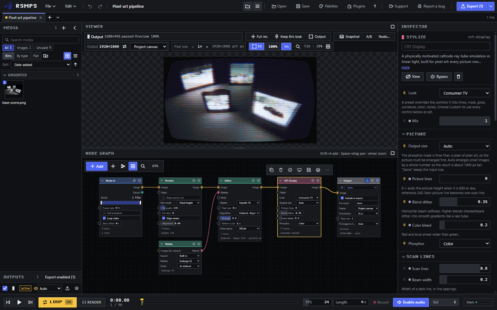

RSMPS started as PixelArtify Studio, a pixel-art converter made for the game *Filmmaker Survivor*. It is now a general media
processing suite built like Blender's shader nodes or DaVinci Fusion: small nodes that receive data on their inputs and pass
results along their wires.

> MIT licensed · local-first · no account · no upload · your media stays on your machine.

**Live demo:** <https://gustafmos.github.io/rsmps/> · **Desktop app:** [Releases](https://github.com/GustafMos/rsmps/releases) · **Changelog:** [CHANGELOG.md](CHANGELOG.md)

---

## What it looks like

One picture (a 3D render of old CRT televisions showing sea footage, by the author), eight looks. Every tile is a small graph of one to three nodes, rendered through the same engine the app
uses (the graphs are in [scripts/screenshots/graphs](scripts/screenshots/graphs)).

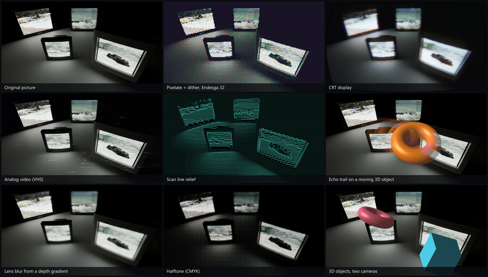

The pixel-art and CRT look in motion (a looping render of the same picture scrolling through Pixelate, Dither and CRT Display):

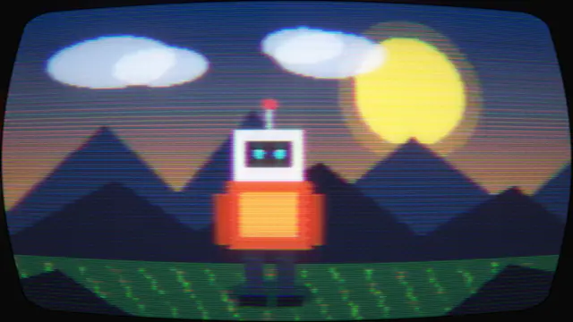

### Made with RSMPS: mixed-media examples

Two animations made with the Print and scan workflow (see below): the frames were printed on paper, drawn on and collaged
by hand, photographed, and recovered by RSMPS as an animation.

| | |
| --- | --- |
| 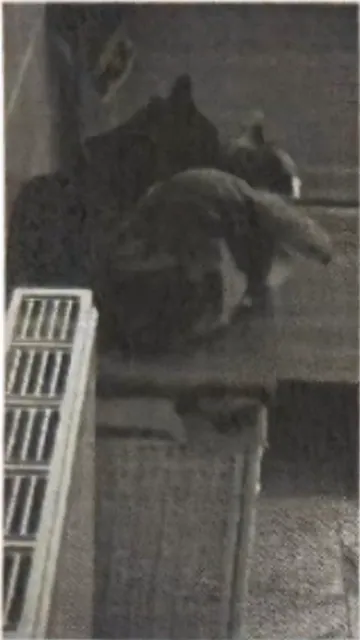 | 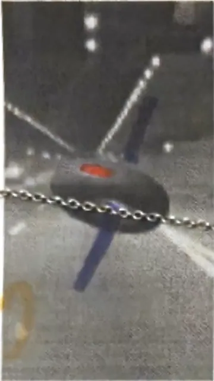 |
| Cats on a shelf, printed and scanned back | Ink, paper and a coin on top of a printed animation |

Footage and scans by the author.

---

## What it does

- **Real node graph.** Every node is a pure function of its inputs and settings. An effect placed after another effect
  processes that effect's result; there is no hidden fixed pipeline.
- **Batch by design.** Put many files in a Media In node and the graph runs once per file. Lengths are authored in unit
  pixels and scaled to each file, so a 480p and a 4K source get the same look.
- **GPU everywhere.** One WebGPU device; images stay on the GPU from decode to display. Results are cached per node and only
  nodes that read the clock re-render per frame.
- **One-click looping.** Turn on Loop and every built-in animator repeats exactly over the project duration. `Make Loop`
  cross-fades any footage into a seamless loop.
- **Compare, queue, share, start fast.** Snapshots of the viewer with A/B compare (wipe at any angle, side by side, toggle, onion, difference) and one-click
  "what did this node change"; a render queue that renders several projects one after another; sharing a look as a small file or a link (without your media);
  a start screen with templates; stop-motion capture from a camera with onion skin. See [docs/RECIPES.md](docs/RECIPES.md).
- **Groups and repeat groups.** Select nodes and press Ctrl+G: they become one node with exposed settings; a repeat group applies its nodes N times (see Infinite Zoom below).
- **Live and reactive.** Beat Detect and "React to sound" on any number setting, MIDI learn on any setting, and an interface-free Output window for a projector.
- **Color grading and new looks.** White Balance, Lift Gamma Gain, Curves (including Hue vs Sat), Exposure, LUT, HSL Qualifier and a Scope; Subtitles, Digital Glitch, Analog Video, Infinite Zoom, Array, Kaleidoscope, Feedback, Material 2D and Normal Map.
- **3D and splats.** SDF 3D, Image to 3D, 3D Array, Materials, Gaussian Splat files, Picture to Splats, AI Depth (optional model, never downloaded by itself) and Splat from Video (desktop app, optional add-ons).
- **More than 220 nodes** in 16 families, each one file under `src/engine/nodes/`: Input, Output, Generate, Color, Filter,
  Stylize, Pixel Art, Transform, Composite, Mask, Detect & Track, Time, Math & Utility, Audio Source, Audio Effects,
  Synth & MIDI.

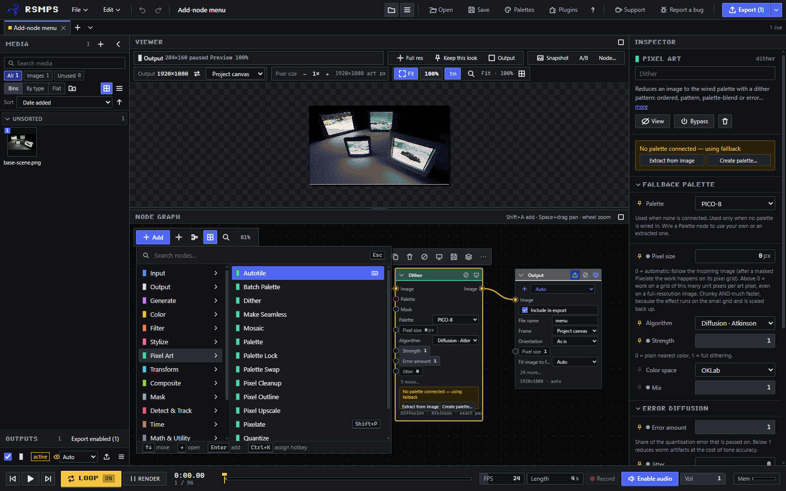

### Pixel art, palettes and dithering

Edge-aware pixelation, palettes (built-in, custom, extracted from an image), 27 dither algorithms, palette swap and crisp
upscale. **Palette Studio** (the *Palettes* button) builds palettes from color harmonies, ramps or an image, checks
accessibility, and sends the result to a Palette node.

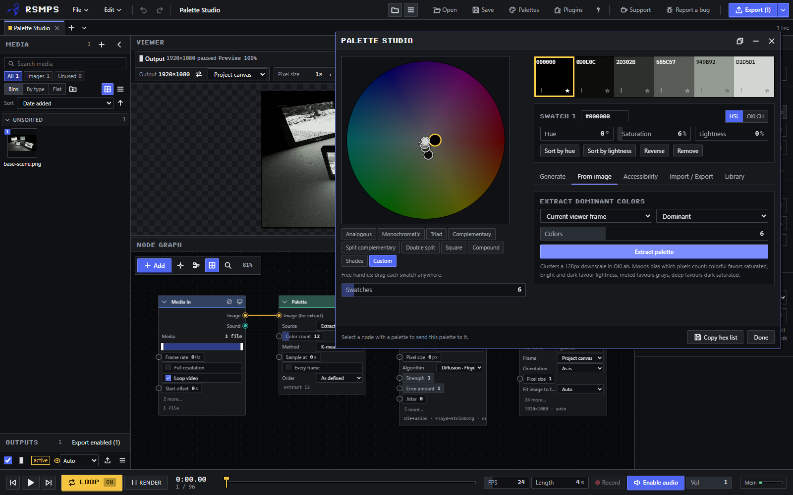

### CRT, analog video and other looks

CRT Display models the tube (scan lines locked to the art pixels, phosphor mask, glow, curvature), Analog Video the tape and
RF chain. There are also scan lines, scan line relief, halftone, grain, bloom, lens blur, echo and feedback trails, pixel
sorting, kuwahara and watercolor styles, outlines and more. Number, color and palette parameters can be driven by a wire.

### Groups and Infinite Zoom

Select nodes and press Ctrl+G to bundle them into one node that shows only the settings you expose. Infinite Zoom makes a picture contain a smaller copy of
itself, forever, while the camera falls in; with Loop on it repeats exactly. Below, a letter with a hole is bundled with its Infinite Zoom in a group whose letter and copy scale are exposed on the group node.

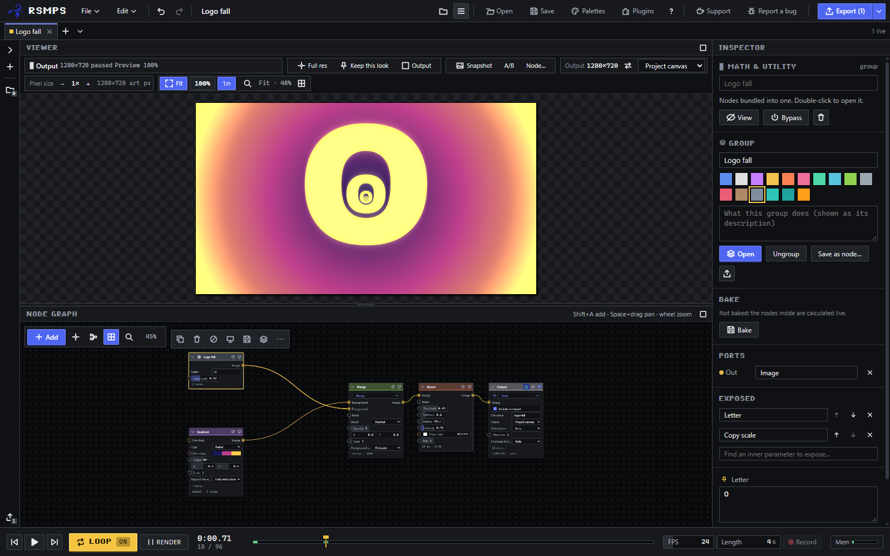

### Captions and subtitles

The Subtitles node turns an .srt or .vtt file (or lines you type, with optional times) into styled captions: words pop in time, highlight the spoken word, and fit any frame, such as a vertical 1080 by 1920 video.

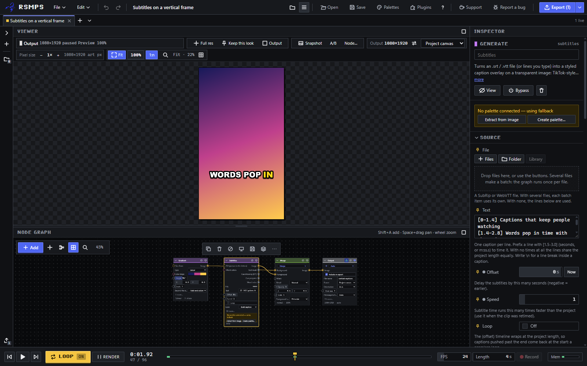

### Materials on flat pictures

Material 2D turns the transparency of a flat picture into a bevelled object lit by any Material node: chrome, gold, plastic, clay, glass, toon, hologram or wire contours.

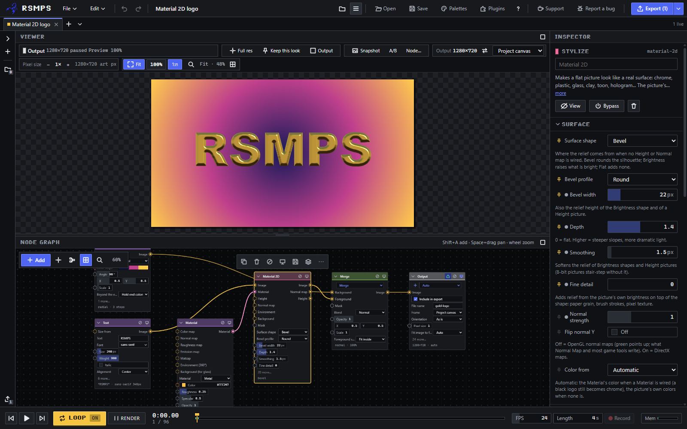

### 3D generators, cameras and animation

Primitive 3D objects with their own 3D Camera nodes (perspective, orthographic, isometric, dimetric, fisheye, 360 degree
panoramic and cylindrical), plus gradients, noise, patterns, shapes, particles and text. Animate and Keyframes nodes drive any
number parameter; the curve editor edits keyframes, splines and bezier handles.

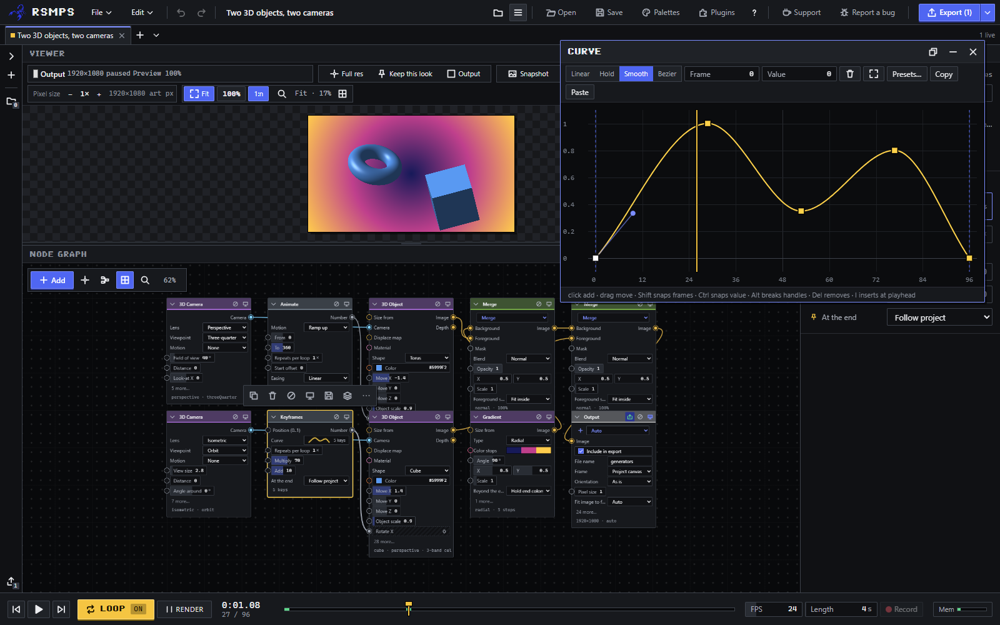

### Audio and MIDI in the same graph

Microphone, audio files, a MIDI keyboard, MIDI devices, pitch-to-MIDI, synths, drums, a sampler, compressor, EQ, delay, reverb
and more, mixed by wiring and arranged on an Audio Timeline node with audio and MIDI tracks (record into it, loop it, quantize).
Sound can drive pictures: *Sound to Numbers* turns loudness, bass/mid/treble and pitch into numbers for any parameter, and
MIDI notes and values do the same.

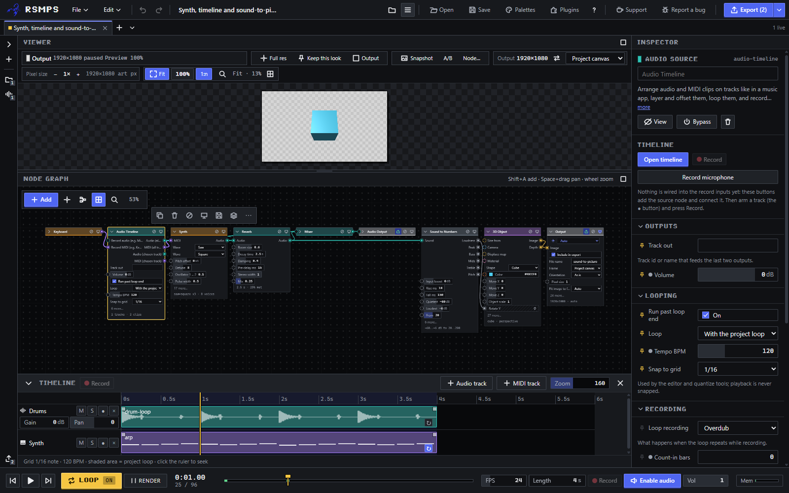

### Masks, cut-outs and parallax

Color and luma keys, subject mask, paint mask, inpainting that fills a cut-out from its edges, layer splitting and a looping
parallax camera.

### Detect and track

Blob, color and motion detectors, a tracker, and *Regions to Mask* so any effect can be limited to tracked areas; HUD
overlays, trails, follow-crop and sprite stamping.

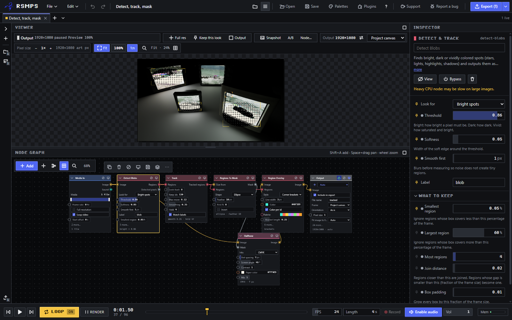

### Print and scan back

Export animation frames as printable sheets with registration marks, draw on them, photograph them, and get the frames back
aligned as an image sequence. The two mixed-media examples near the top of this page were made this way. The Scan tab finds the markers, corrects tilt and perspective, cuts the frames and hands them to
a clean-up graph. The picture below is a sheet the app printed itself, "photographed" synthetically (tilted, on a
table-colored background) and read back; see [docs/PRINT_AND_SCAN.md](docs/PRINT_AND_SCAN.md).

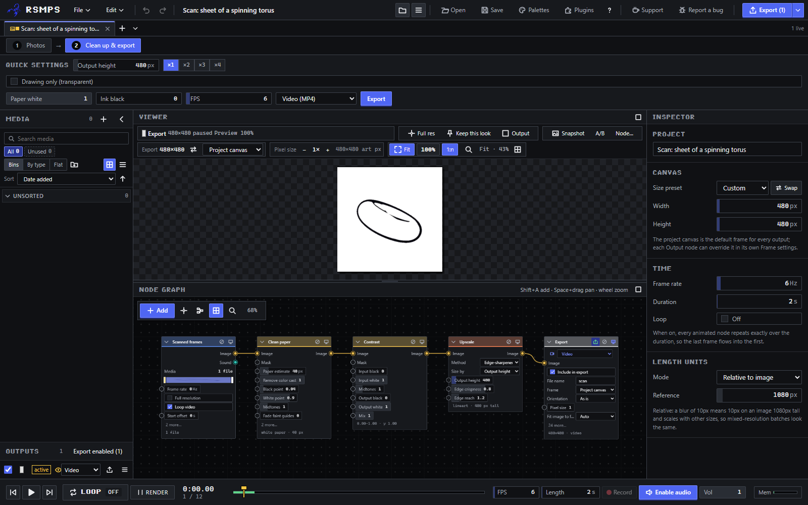

### On a phone or tablet

The same project opens on a phone with a layout of its own (View, Graph, Inspector, Media and More tabs, touch gestures, an add sheet instead of menus). The picture shows the desktop window and the phone layout side by side.

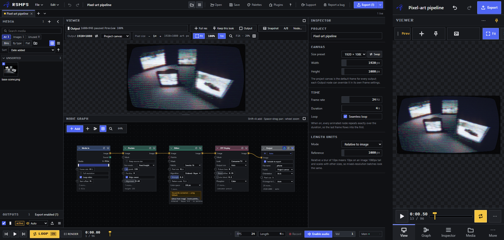

### Plugins

A plugin is one JavaScript file exporting a node definition; it appears in the menus like a built-in
([docs/PLUGINS.md](docs/PLUGINS.md)).

---

## Quick start

You need Node.js 20 or newer.

```bash
npm install
npm run dev
```

Open <http://localhost:5173>. A browser with WebGPU is required (current Chrome or Edge, or another browser that ships WebGPU
on your system).

If a setting ever makes rendering hang, open `http://localhost:5173/?safe`: the project loads without rendering so you can
fix it, then remove `?safe`.

### Working in the graph

- **Shift+Space** or **Shift+A**: search and add a node. With a node selected, the new node is inserted into its chain.
- Drop a wire from one output onto another output to create a Merge with the held one on top.
- Click a color to open the built-in picker; **Palettes** opens Palette Studio (harmony wheel, ramps, extract from image).
- **L** arranges the graph, **F** frames it, **B** bypasses the selected nodes.
- Shortcuts are listed under **?** and can be rebound; any node type can be given its own hotkey.

### Phone as a camera (optional)

`npm run dev:lan` serves the app over https on your local network so a phone can act as a live camera through a QR code (the
Phone Camera node). The phone will warn that the connection is not private: choose Advanced, then Proceed. It is your own
computer. The other live inputs (Webcam, URL / Stream) are described in [docs/LIVE_INPUT.md](docs/LIVE_INPUT.md).

## Desktop app

The desktop app is the same web app in an Electron shell: it runs offline and comes as an installer (Windows), a dmg (macOS)
or an AppImage (Linux). It is built by GitHub Actions for tagged releases and is currently **unsigned**, so Windows
SmartScreen and macOS Gatekeeper show a one-time warning ([docs/RELEASING.md](docs/RELEASING.md) explains how to get past it).

- **Free:** download the builds from [Releases](https://github.com/GustafMos/rsmps/releases) once a release is published, or
  build them yourself with `npm run desktop:build` (current OS) and check with `npm run desktop:smoke`.
- **Pay what you want:** the same builds are sold as a convenience on itch.io and Gumroad. The money supports development;
  the source stays MIT and nothing is held back. itch.io: TODO (page not published yet) · Gumroad: TODO (page not published
  yet). See [docs/STORE.md](docs/STORE.md).

**Update check:** the desktop app asks GitHub once a day whether a newer version exists and sends nothing else (no account, no identifiers). It only tells you; it never downloads or installs anything. Turn it off in File > About RSMPS.

The desktop app does not include FFmpeg. ProRes-compatible export and video with transparency need the optional FFmpeg
add-on (Plugins > Add-ons): it downloads FFmpeg from its official source only when you ask, or you can point the app at an
FFmpeg you already have. The command line below can do the same with your own FFmpeg. The phone link runs inside the
desktop app.

**Splat from Video (desktop app, optional add-ons).** The Splat from Video node turns a clip or a photo set into a 3D
Gaussian splat scene and gives back the original camera move. It runs two separate open-source programs on your computer:
COLMAP (BSD-3-Clause, finds the cameras) and Brush (Apache-2.0, trains the splats). They are large (130 to 415 MB downloads),
not code-signed on Windows, and never included or downloaded by themselves: install them in Plugins > Official add-ons
(pinned versions checked against a SHA-256) or locate copies you already have. Nothing is uploaded. See
[docs/SPLATS.md](docs/SPLATS.md) for what footage works.

**Optional AI model (browser and desktop).** The **AI Depth** node makes real depth maps with Depth Anything V2 Small
(Apache-2.0, 50 MB). The model is not part of RSMPS and is never downloaded by itself: Plugins > AI models has a Download
button, and only pressing it fetches the file from huggingface.co (a pinned version, checked against a known SHA-256 before
it is used). It runs locally on your own GPU through WebGPU (on the processor, slowly, if there is no WebGPU); **nothing is
uploaded**. The larger Depth Anything V2 models are non-commercial and are not offered. The command line cannot run it: it
uses a result you made in the app, or the quick Depth from Picture guess. Credit: "Depth Anything V2 Small © the Depth
Anything authors, Apache-2.0"; the runtime is [ONNX Runtime Web](https://github.com/microsoft/onnxruntime) (MIT).

## Command line

Batch rendering without a browser, including formats browsers cannot encode (ProRes-compatible 4444 with alpha):

```bash
npm run cli -- render my-graph.rsmps.json sprites/ --out out/
npm run cli -- nodes          # every node with its sockets and parameters
```

Video and ProRes output (and video, audio or GIF input) need ffmpeg: the optional `@ffmpeg-installer/ffmpeg` dependency, or
your own on PATH or in `$FFMPEG_PATH`. Still images, PNG sequences and spritesheets do not. See [docs/CLI.md](docs/CLI.md).
The showcase renders above were made this way.

## Documentation

| | |
| --- | --- |
| [docs/ENGINE.md](docs/ENGINE.md) | How the engine works and how to add a node (start here to contribute) |
| [docs/PLUGINS.md](docs/PLUGINS.md) | Writing and installing plugins |
| [docs/CLI.md](docs/CLI.md) | Command-line rendering |
| [docs/PRINT_AND_SCAN.md](docs/PRINT_AND_SCAN.md) | Printing frame sheets and scanning them back |
| [docs/LIVE_INPUT.md](docs/LIVE_INPUT.md) | Webcam, URL / Stream and phone inputs |
| [docs/RELEASING.md](docs/RELEASING.md) | Building and releasing the desktop app |
| [docs/STORE.md](docs/STORE.md) | What the store builds are and how they are described |
| [src/engine/audio/README.md](src/engine/audio/README.md) | Audio and MIDI nodes, and driving pictures with sound |

## Layout

```text
src/engine/   the engine: node contract, evaluator, GPU helpers, all nodes, audio
src/io/       media library, playback, export, plugins, project files, print/scan
src/ui/       the React interface (generated from node definitions)
src/cli/      headless renderer
desktop/      the Electron shell
scripts/screenshots/   regenerates the pictures in this README
```

## Tests

```bash
npm run check   # typecheck + all tests
```

Node tests run on the real GPU through headless WebGPU, so a passing test also proves the shader compiles.

## Regenerating the pictures

Build once with the editor handle the scripts drive (no dev server is needed; `npm run dev` in another terminal also works, then leave out `--dist`):

```bash
VITE_RSMPS_QA=1 npx vite build --outDir /tmp/rsmps-shots --emptyOutDir
npx electron scripts/screenshots/capture.mjs --dist /tmp/rsmps-shots    # UI screenshots (hidden window, separate in-memory profile)
node scripts/screenshots/optimize.mjs           # keep each screenshot small
npx electron scripts/screenshots/responsive.mjs --dist /tmp/rsmps-shots --scenes scripts/screenshots/qa-scenes.mjs   # QA pass over the desktop layout: PNGs and qa-report.json in the OS temp folder
node scripts/screenshots/make-graphs.mjs        # the small graphs behind the looks
node scripts/screenshots/render-showcase.mjs    # looks.png, anim-crt.webp and the store crops in docs/store/assets
npx electron scripts/screenshots/video-to-webp.mjs my-scan.mp4 --webp docs/screenshots/scan-example-1.webp --dur 4 --fps 15
```

The last command turns a video into a looping animated WebP with Electron's decoder (no ffmpeg needed); add `--contact sheet.png` to preview a video as a grid of frames.

The capture uses only generated content, `test-assets/` and the author's base picture in `scripts/screenshots/assets/`; nothing from your own projects or library.

## Known limitations

- WebGPU is required; there is no fallback for browsers or machines without it.
- The microphone and MIDI devices are live-only. For export, record the take (the Audio Timeline node records audio and MIDI); a
  recorded take exports like any other clip.
- Webcam, URL / Stream and Phone Camera pictures are live-only too: record them to a file first to render them.
- ProRes-compatible export needs FFmpeg: the optional add-on in the desktop app, or your own FFmpeg on the command line. FFmpeg is never bundled.
- Splat from Video works only in the desktop app with the COLMAP and Brush add-ons, needs a graphics card Brush can use, and needs footage with real camera movement around a still, textured subject. It has been measured on synthetic scenes only; real phone footage will often be harder (docs/SPLATS.md). The command line cannot run it.
- AI Depth (optional) needs a 50 MB model you download yourself and runs on your GPU (about 40 ms a frame on an RTX 3080) or, without WebGPU, on the processor (about 3 s a frame). Depth from Picture, subject extraction, the detectors and the tracker are classical methods, not neural networks: expect touch-ups when subject
  and background share colors, and occasional id swaps when tracked objects cross.
- The phone link needs `npm run dev:lan` and is not available in the desktop app.
- Error-diffusion dithers fall back to an ordered pattern on very large images.
- The desktop builds are unsigned and do not update themselves; the macOS and Linux builds come from CI and have had less
  testing than the Windows one.

## Credits

RSMPS stands on the shoulders of open-source work. See [CREDITS.md](CREDITS.md) and
[THIRD_PARTY_NOTICES.md](THIRD_PARTY_NOTICES.md) for full links and licenses.

Special thanks to:

- **Yogthos** — [pixel-mosaic](https://github.com/yogthos/pixel-mosaic) (MIT), the edge-aware pixelation inspiration.
- **Robert Kist** — [Ditherista](https://github.com/robertkist/ditherista) and [libdither](https://github.com/robertkist/libdither), the dithering catalog inspiration.
- **Vanilagy** — [Mediabunny](https://mediabunny.dev) (MPL-2.0), browser media I/O.
- **Björn Ottosson** — [OKLab](https://bottosson.github.io/posts/oklab/) (MIT).
- **MaxK1920** — [stardetect](https://github.com/MaxK1920/stardetect), the inspiration for the Detect & Track nodes (no code is shared; RSMPS uses its own classical detectors).
- The pixel-art community behind the PICO-8, Sweetie 16, Endesga 32, DawnBringer 16 and Game Boy palettes.

**Not affiliated.** RSMPS is an independent project. It is not affiliated with, sponsored by or endorsed by Blackmagic Design, the Blender Foundation, Adobe, Ableton, Apple, or any other company, product or creator mentioned here. DaVinci Resolve, Fusion, Blender, Adobe Color, Ableton Live and ProRes are trademarks of their respective owners. They are named only to describe what inspired this tool or what it works with. Adobe Color inspired Palette Studio; Blender's shader nodes and DaVinci Resolve's Fusion page inspired the node workflow.

---

## Support my cats

If you want to support me and my projects, help me fund tasty anti-allergenic food for my two cats, **Carla-Mittersteig von Starhemberg** and **Rosa-Luxemburg von Starhemberg**. <3 Thank you!

**Ko-fi:** <https://ko-fi.com/ripscorpy> · [FUNDING.md](FUNDING.md)

---

## License

MIT. See [LICENSE](LICENSE). Third-party dependencies retain their licenses; Mediabunny is MPL-2.0 and is used unmodified as a dependency.
